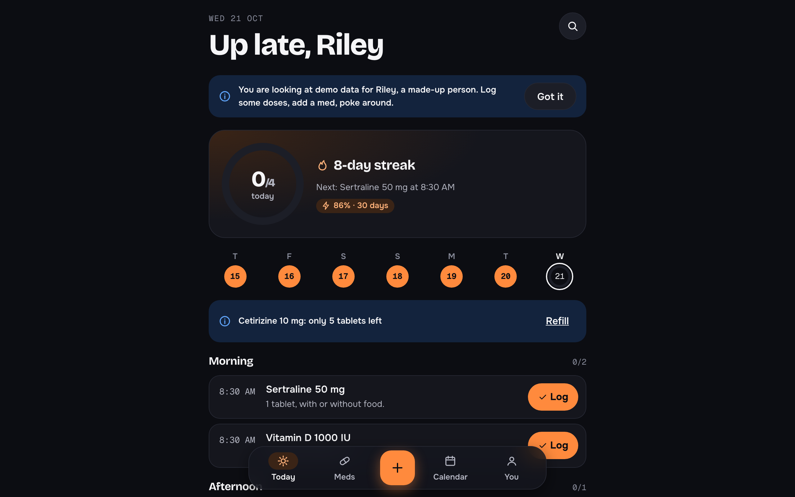
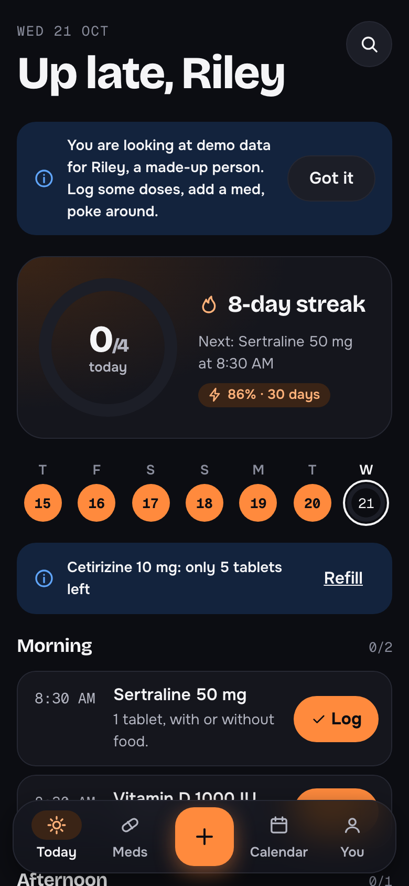
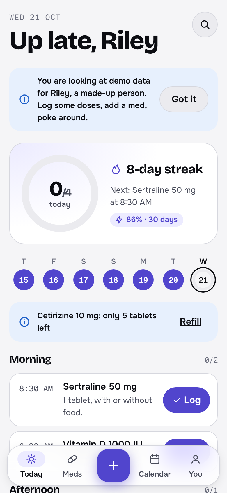
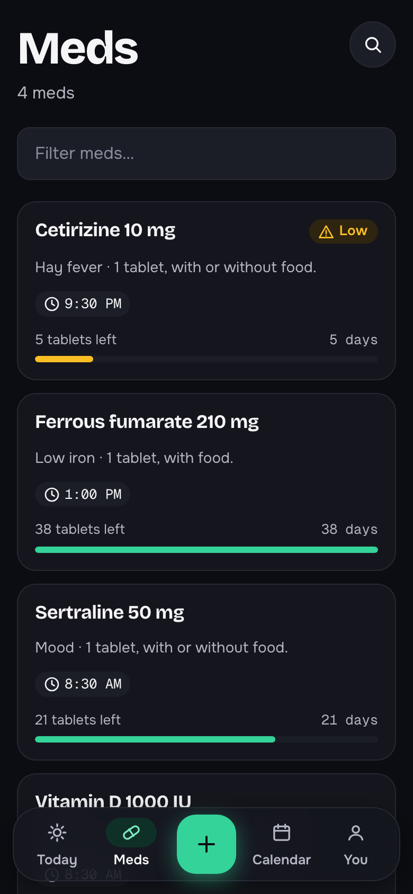
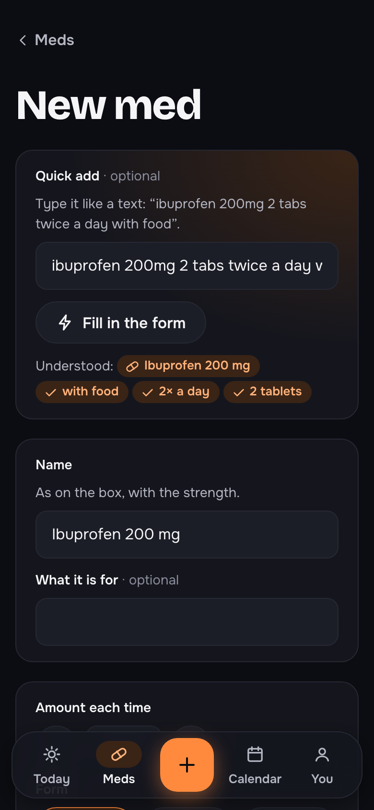
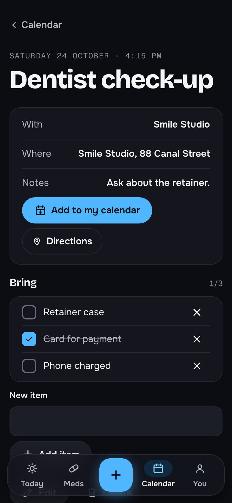
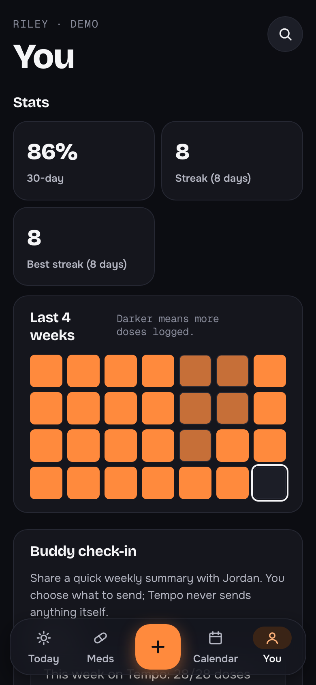
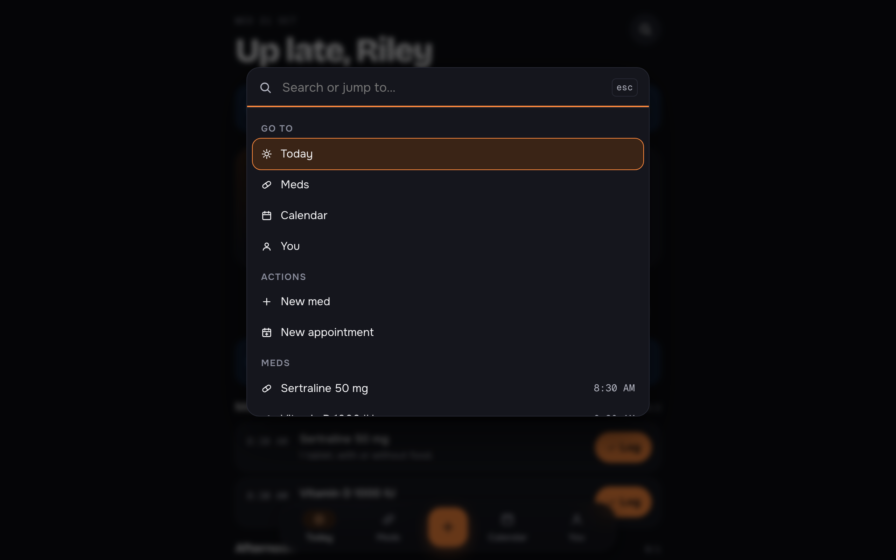

<div align="center">

# Tempo

**Meds and appointments, on beat.**
A fast, dark-first medication and appointment tracker for young, tech-savvy people.

[](https://github.com/AnushkaUpadhyay1/tempo/actions/workflows/ci.yml)




</div>

> [!IMPORTANT]
> Tempo is a **design concept** with demo data for a fictional 24-year-old ("Riley"). It does not give medical advice, does not send notifications, and does not replace a doctor or pharmacist.

---

## Contents

- [Why Tempo](#why-tempo)
- [Screenshots](#screenshots)
- [Features](#features)
- [Quick start](#quick-start)
- [Keyboard shortcuts and gestures](#keyboard-shortcuts-and-gestures)
- [Quick add: how the parser works](#quick-add-how-the-parser-works)
- [Design system: Tempo UI](#design-system-tempo-ui)
- [Accessibility](#accessibility)
- [Architecture](#architecture)
- [Testing](#testing)
- [Your data](#your-data)
- [Offline and installing](#offline-and-installing)
- [Deployment](#deployment)
- [Roadmap](#roadmap)
- [License](#license)

---

## Why Tempo

Tempo is the sibling of [**Clearway + Steady**](https://github.com/AnushkaUpadhyay1/clearway-steady), which was designed for adults aged 65+. Tempo keeps Steady's tested data layer and rebuilds the interface for people who live on their phones: they expect speed, gestures, keyboard shortcuts, personalisation, and feedback that feels good.

|                | Steady (65+)                           | **Tempo (young, tech-savvy)**                                    |
| -------------- | -------------------------------------- | ---------------------------------------------------------------- |
| Look           | Calm, light, 18 px body, 48 px targets | Dark-first, bold display type, 16 px body, 44 px targets         |
| Logging a dose | One large button                       | Tap **Log** _or_ swipe the row right                             |
| Adding a med   | Six-step wizard                        | One page, plus **Quick add** from a single sentence              |
| Navigation     | Five labelled tabs                     | Floating tab bar, centre **+**, and a **⌘K** command menu        |
| Motivation     | Calm completion message                | Progress ring, streaks, week strip, 4-week heatmap, 30-day score |
| Sharing        | Family view                            | Buddy check-in you share or copy                                 |
| Calendar       | Checklist                              | Checklist, **Add to my calendar** (.ics), **Directions**         |
| Personalising  | Text size, 3 themes                    | Auto / light / dark, 4 accents, compact to larger text, haptics  |
| Data           | Local only                             | Local, plus **JSON export and import**                           |

## Screenshots

|                                              Today (dark)                                              |                                         Today (light, violet accent)                                         |                                          Meds (mint accent)                                           |
| :----------------------------------------------------------------------------------------------------: | :----------------------------------------------------------------------------------------------------------: | :---------------------------------------------------------------------------------------------------: |
|  |  |  |

|                                                                                      Quick add                                                                                      |                                                    Appointment (sky accent)                                                    |                                 You: stats and settings                                 |
| :---------------------------------------------------------------------------------------------------------------------------------------------------------------------------------: | :----------------------------------------------------------------------------------------------------------------------------: | :-------------------------------------------------------------------------------------: |
|  |  |  |

<div align="center">

<p><em>⌘K / Ctrl+K opens the command menu from anywhere.</em></p>
</div>

## Features

### Today

- **Progress ring** showing doses logged today, with the current **streak** and what's **next up**
- **7-day strip:** each day is a small ring filled by the share of doses logged
- **Swipe a dose right** to log it, or tap **Log**. Undo is in the toast, and **Undo log** stays on the row afterwards
- Overdue doses get a warning pill, a thicker border and a plain explanation
- **Low supply** nudges with a link to refill
- Optional **haptic** buzz when you log (on phones that support it)

### Meds

- Cards with schedule chips, a **supply bar** with days left, and a **Low** badge
- Instant **filter**
- Detail page with **30-day adherence**, days left, a **Refilled** action that adds to the supply, edit, and delete with confirmation
- One-page form with **Quick add**, preset and exact times, and a draft that is saved and restored

### Calendar

- Grouped into **Next 7 days**, **Later** and **Past**
- **Add to my calendar** downloads a standards-compliant `.ics` event (RFC 5545 escaping is tested)
- **Directions** opens your maps app
- A "Bring" checklist that remembers what's packed

### You

- **Stats:** 30-day adherence, current streak and best streak
- **4-week heatmap,** with every day labelled in words for screen readers
- **Buddy check-in:** an editable weekly summary you share (Web Share) or copy. Tempo never sends anything itself
- **Appearance:** Auto / Light / Dark, four accents (tangerine, violet, mint, sky), text size (Compact 90%, Default, Large 115%, Larger 130%), reduce motion, haptics
- **Your data:** export a JSON backup, import one (validated), or reset the demo

### Everywhere

- **⌘K / Ctrl+K** command menu: jump to any screen or med, log due doses, add things, switch theme or accent
- Floating **tab bar** with a centre **+** that opens Quick add
- Installable PWA that **works offline**

## Quick start

**Requirements:** Node.js **22.18+**.

```sh
git clone https://github.com/AnushkaUpadhyay1/tempo.git
cd tempo
npm install
npm run dev            # http://localhost:5173
```

| Command                           | What it does                                                        |
| --------------------------------- | ------------------------------------------------------------------- |
| `npm run dev`                     | Generate tokens and start the dev server                            |
| `npm run tokens`                  | `tokens/tokens.json` → `src/styles/tokens.css`                      |
| `npm run contrast`                | Check every colour pair in 2 themes × 4 accents against WCAG 2.2 AA |
| `npm run icons`                   | Redraw the PWA icons                                                |
| `npm run lint`                    | ESLint with `jsx-a11y` strict, zero warnings                        |
| `npm run format` / `format:check` | Prettier                                                            |
| `npm run typecheck`               | TypeScript strict                                                   |
| `npm test`                        | Vitest + Testing Library + axe                                      |
| `npm run build`                   | Production build with a generated service worker                    |
| `npm run check`                   | All of the above, in order. CI runs this                            |

## Keyboard shortcuts and gestures

| Input                             | Action                                                 |
| --------------------------------- | ------------------------------------------------------ |
| **⌘K** / **Ctrl+K**               | Open or close the command menu                         |
| **↑ ↓**, **Enter**, **Esc**       | Move through, run, or close command menu results       |
| **← →**                           | Change option in segmented controls (theme, text size) |
| **Swipe right** on a dose (touch) | Log it. The **Log** button always does the same thing  |
| **Esc**                           | Close any sheet                                        |

Swipes only respond to touch and pen, never mouse drags, and vertical scrolling is never captured.

## Quick add: how the parser works

`src/data/quickAdd.ts` turns a sentence into form fields and shows what it understood as chips. You can always edit the result.

| You type                                       | Tempo fills in                                                  |
| ---------------------------------------------- | --------------------------------------------------------------- |
| `ibuprofen 200mg 2 tabs twice a day with food` | **Ibuprofen 200 mg**, 2 tablets, 8:00 AM and 8:00 PM, with food |
| `melatonin 3mg at 10:30pm`                     | **Melatonin 3 mg**, 10:30 PM                                    |
| `cetirizine 10mg at night`                     | **Cetirizine 10 mg**, 10:00 PM                                  |
| `salbutamol 2 puffs`                           | **Salbutamol**, 2 puffs                                         |
| `omeprazole 20mg before food`                  | **Omeprazole 20 mg**, before food                               |
| `omega 3 capsule daily`                        | **Omega 3**, 1 capsule, 8:00 AM (the 3 stays in the name)       |

It recognises strengths (mg, mcg, g, IU, units), units (tablets, capsules, ml, puffs, drops, sachets), frequency (once, twice, 3×, bd, tds…), clock times (9am, 21:30), moments (morning, lunch, evening, night) and food rules.

## Design system: Tempo UI

**Tokens** live in [`tokens/tokens.json`](tokens/tokens.json): a cool ink neutral scale, two themes (light and dark), and **four accents**, each with tuned light and dark values (`fill`, `fill-hover`, `on-fill`, `text`, `soft`). Themes come from `data-theme` and accents from `data-accent` on `<html>`.

**Type:** Bricolage Grotesque (display), Onest (body) and Geist Mono (times and numbers). All are bundled, so they work offline.

**Components** in `src/ui`: Button / ButtonLink, IconButton, Icon, Field, ChipGroup, Checkbox, Switch, Segmented, Sheet (a bottom sheet on phones), Toast with Undo, ProgressRing, Pill, Banner, EmptyState, SwipeAction, TabBar, CommandPalette.

## Accessibility

Built for a younger audience, with accessibility kept. Details are in [`A11Y_AUDIT.md`](A11Y_AUDIT.md).

| Check                                                                 | Result                                   |
| --------------------------------------------------------------------- | ---------------------------------------- |
| Colour contrast, 2 themes × 4 accents                                 | **118 / 118 pass WCAG 2.2 AA**           |
| axe-core scans                                                        | **0 violations** (8 scans)               |
| ESLint `jsx-a11y` strict                                              | **0 errors, 0 warnings**                 |
| 54 page loads (both themes, 320 / 390 / 1280 px, 130% text at 320 px) | No sideways scrolling, no console errors |
| Touch targets                                                         | 44 px or more                            |

- Gestures are always optional (WCAG 2.5.1)
- Status always uses words and an icon, never colour alone
- Native radios, checkboxes and dialogs; ARIA only where needed (switch, combobox/listbox, meter)
- Focus moves to the new heading after navigation and to error summaries after failed saves
- Reduced motion turns off springs, slides and the ring animation

> **Not yet tested:** VoiceOver, TalkBack, NVDA, real devices and real users.

## Architecture

```
tokens/tokens.json   Themes (light, dark) × accents (tangerine, violet, mint, sky)
scripts/             build-tokens.ts · check-contrast.ts · generate-icons.ts
src/
  app/               Routes, AppShell (tab bar, ⌘K, add sheet), copy.ts
  ui/                Tempo UI components + tests
  components/        DoseRow, WeekStrip, Heatmap, NumberField, PageHeader
  screens/           Today, Meds, Med detail and form, Calendar, Appointment detail and form, You
  data/              Types, validation, storage, demo data, schedule, stats, quickAdd, forms
  settings/          Theme, accent, text size, motion, haptics
  lib/               Colour maths, time, .ics export, file reading, hooks
```

**Stack:** Vite · React 19 · TypeScript (strict) · React Router 7 · CSS Modules · Vitest · Testing Library · vitest-axe · ESLint · Prettier.

## Testing

`npm run check` runs **82 tests in 10 files**, covering:

- the quick-add parser, streaks, adherence and the heatmap
- token contrast for every theme and accent
- UI components: keyboard use, the swipe threshold and vertical-scroll rejection, sheet focus, the command menu
- flows: logging and undoing, swipe-to-log, ⌘K logging, quick add to save, form validation and drafts, refill, edit and delete, calendar checklist and `.ics` export, theme and accent persistence, export and import, demo reset
- every route loading directly

GitHub Actions runs it on every push ([`.github/workflows/ci.yml`](.github/workflows/ci.yml)).

## Your data

Everything stays in your browser (`localStorage`, key `tempo.data.v1`). Stored data and imported backups are validated record by record. **Export JSON** makes a backup and **Import JSON** restores one, so you can move between devices.

## Offline and installing

The build generates a service worker that precaches every file. After one visit, every screen works offline. Install it from the browser menu ("Add to Home Screen" or "Install app").

## Deployment

`vercel.json` rewrites all routes to `index.html`. Import the repository in Vercel with the **Vite** preset (`npm run build`, output `dist`), or use any static host with the same rewrite.

## Roadmap

- [ ] Real reminders with push notifications
- [ ] Sync across devices with an account
- [ ] Widgets and lock-screen logging
- [ ] Screen reader and user testing

## License

[MIT](LICENSE) © 2026 Anushka Upadhyay
